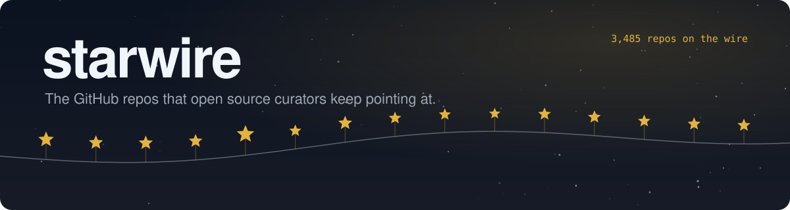

<a href="#-trending">🔥 Trending</a>&nbsp;&nbsp;&nbsp;
<a href="#-new-this-week">🆕 New this week</a>&nbsp;&nbsp;&nbsp;
<a href="#-picked-again-and-again">🔁 Picked again and again</a>&nbsp;&nbsp;&nbsp;
<a href="#-browse-by-area">🗂️ Areas</a>&nbsp;&nbsp;&nbsp;
<a href="#-submit-a-repo">➕ Submit a repo</a>

 

## 🔥 Trending

Gaining stars fastest right now for their size. Stars are counted daily and only measured gains are used. Until a repo has a week of counts, it shows the days measured so far; for repos under 30 days old the missing days use their own average, marked ~.

| Repo | About |
| :-- | :-- |
|  **[craft-anything](https://github.com/storytold/craft-anything)** storytold ⭐&nbsp;**22k** | Tool for learning how software works by crafting your own version  📚 Learning & reference › Courses & tutorials&nbsp;&nbsp;·&nbsp;&nbsp;📈 ~+21k stars a week&nbsp;&nbsp;·&nbsp;&nbsp;🟢 updated today&nbsp;&nbsp;·&nbsp;&nbsp;Apache-2.0&nbsp;&nbsp;·&nbsp;&nbsp;4.3k forks |
|  **[unslop](https://github.com/heydamir/unslop)** heydamir ⭐&nbsp;**12k** | Claude skill that redesigns AI looking UI into a more deliberate interface   🌐 Web & frontend › UI components & design systems&nbsp;&nbsp;·&nbsp;&nbsp;📈 ~+6.7k stars a week&nbsp;&nbsp;·&nbsp;&nbsp;🟢 updated 6d ago&nbsp;&nbsp;·&nbsp;&nbsp;CC-BY-4.0&nbsp;&nbsp;·&nbsp;&nbsp;651 forks |
|  **[rea-video](https://github.com/JuneYaooo/rea-video)** JuneYaooo ⭐&nbsp;**4.1k** | Agent skill that breaks a video into shots and explains how to remake it   🎨 Media & design › Video&nbsp;&nbsp;·&nbsp;&nbsp;📈 ~+3.1k stars a week&nbsp;&nbsp;·&nbsp;&nbsp;🟢 updated today&nbsp;&nbsp;·&nbsp;&nbsp;Apache-2.0&nbsp;&nbsp;·&nbsp;&nbsp;579 forks <code>agent-skills</code> <code>ai-video</code> <code>aigc-detection</code> <code>claude-code</code> |
|  **[rune](https://github.com/anomalyco/rune)** anomalyco ⭐&nbsp;**4.6k** | GPU-rendered native UI framework in Rust for desktop and the web  🌐 Web & frontend › UI components & design systems&nbsp;&nbsp;·&nbsp;&nbsp;📈 ~+3.1k stars a week&nbsp;&nbsp;·&nbsp;&nbsp;🟢 updated today&nbsp;&nbsp;·&nbsp;&nbsp;MIT&nbsp;&nbsp;·&nbsp;&nbsp;143 forks |
|  **[pixelfx](https://github.com/patch-gg/pixelfx)** patch-gg ⭐&nbsp;**6.0k** | Collection of 244 pixel art effects in JavaScript plus a Claude Code skill  🎨 Media & design › Images & graphics&nbsp;&nbsp;·&nbsp;&nbsp;📈 ~+3.2k stars a week&nbsp;&nbsp;·&nbsp;&nbsp;🟢 updated 8d ago&nbsp;&nbsp;·&nbsp;&nbsp;MIT&nbsp;&nbsp;·&nbsp;&nbsp;781 forks <code>agent-skills</code> <code>animation</code> <code>canvas</code> <code>claude-code-plugin</code> |
|  **[openidea](https://github.com/l0ng-ai/openidea)** l0ng-ai ⭐&nbsp;**7.8k** | Native IDE in Rust with an IntelliJ-style keymap, debugger, Git and terminal   🛠️ Developer tools › Editors & IDEs&nbsp;&nbsp;·&nbsp;&nbsp;📈 ~+3.3k stars a week&nbsp;&nbsp;·&nbsp;&nbsp;🟢 updated today&nbsp;&nbsp;·&nbsp;&nbsp;Apache-2.0&nbsp;&nbsp;·&nbsp;&nbsp;672 forks <code>code-editor</code> <code>cross-platform</code> <code>dap</code> <code>database-client</code> |
|  **[player](https://github.com/livliv-dev/player)** livliv-dev ⭐&nbsp;**1.3k** | 2.5D web character player with lip sync and webcam face tracking  🌐 Web & frontend › Animation & 3D on the web&nbsp;&nbsp;·&nbsp;&nbsp;📈 +1.3k stars a week&nbsp;&nbsp;·&nbsp;&nbsp;🟢 updated today&nbsp;&nbsp;·&nbsp;&nbsp;Apache-2.0&nbsp;&nbsp;·&nbsp;&nbsp;135 forks <code>avatar</code> <code>character</code> <code>face-tracking</code> <code>lip-sync</code> |
|  **[sand3d](https://github.com/Sandflow-ai/sand3d)** Sandflow-ai ⭐&nbsp;**1.3k** | Python library for writing 3D models as code, meant for LLMs to generate  🎨 Media & design › 3D & CAD&nbsp;&nbsp;·&nbsp;&nbsp;📈 +1.3k stars a week&nbsp;&nbsp;·&nbsp;&nbsp;🟢 updated 2d ago&nbsp;&nbsp;·&nbsp;&nbsp;Apache-2.0&nbsp;&nbsp;·&nbsp;&nbsp;142 forks <code>3d</code> <code>blender</code> <code>cad</code> <code>llm</code> |
|  **[teardown](https://github.com/elvarofficial/teardown)** elvarofficial ⭐&nbsp;**2.6k** | Claude Code skill that generates a 3D model of a machine to disassemble  🎨 Media & design › 3D & CAD&nbsp;&nbsp;·&nbsp;&nbsp;📈 ~+1.7k stars a week&nbsp;&nbsp;·&nbsp;&nbsp;🟢 updated 7d ago&nbsp;&nbsp;·&nbsp;&nbsp;MIT&nbsp;&nbsp;·&nbsp;&nbsp;402 forks |
|  **[gpu-unlock](https://github.com/Zagitta/gpu-unlock)** Zagitta ⭐&nbsp;**18k** | Tool that claims to lift FP16 and TF32 tensor throughput on GeForce 20 to 40 series   🦾 Hardware & IoT › Embedded & electronics&nbsp;&nbsp;·&nbsp;&nbsp;📈 ~+4.3k stars a week&nbsp;&nbsp;·&nbsp;&nbsp;🟢 updated 10d ago&nbsp;&nbsp;·&nbsp;&nbsp;1.8k forks |
|  **[kiri](https://github.com/libracoder/kiri)** libracoder ⭐&nbsp;**1.1k** | Small, fast container runtime that runs on macOS, Windows and Linux  ☁️ Infrastructure & DevOps › Containers & Kubernetes&nbsp;&nbsp;·&nbsp;&nbsp;📈 +1.1k stars a week&nbsp;&nbsp;·&nbsp;&nbsp;🟢 updated today&nbsp;&nbsp;·&nbsp;&nbsp;Apache-2.0&nbsp;&nbsp;·&nbsp;&nbsp;72 forks |
|  **[OpenMausBot](https://github.com/milind-soni/OpenMausBot)** milind-soni ⭐&nbsp;**18k** | Open-source Grok Bot alternative where bots run inside a virtual machine   🤖 AI & agents › Agents & automation&nbsp;&nbsp;·&nbsp;&nbsp;📈 +4.3k stars in 2 days&nbsp;&nbsp;·&nbsp;&nbsp;🟢 updated today&nbsp;&nbsp;·&nbsp;&nbsp;Apache-2.0&nbsp;&nbsp;·&nbsp;&nbsp;2.5k forks <code>ai-agents</code> <code>claude-code</code> <code>codex</code> <code>computer-use</code> |
|  **[bla](https://github.com/qybaihe/bla)** qybaihe ⭐&nbsp;**3.4k** | Defense that poisons binaries and bundles to slow AI reverse-engineering agents  🔐 Security & privacy › Reverse engineering&nbsp;&nbsp;·&nbsp;&nbsp;📈 ~+1.7k stars a week&nbsp;&nbsp;·&nbsp;&nbsp;🟢 updated today&nbsp;&nbsp;·&nbsp;&nbsp;MIT&nbsp;&nbsp;·&nbsp;&nbsp;427 forks <code>adversarial-ai</code> <code>claude-code</code> <code>cursor</code> <code>electron-security</code> |
|  **[cleanyourtv](https://github.com/Gathin23/cleanyourtv)** Gathin23 ⭐&nbsp;**54k** | Removes bloatware from Android TV over adb and installs a cleaner launcher   💻 System & desktop › System tools&nbsp;&nbsp;·&nbsp;&nbsp;📈 ~+6.5k stars a week&nbsp;&nbsp;·&nbsp;&nbsp;🟢 updated today&nbsp;&nbsp;·&nbsp;&nbsp;7.0k forks <code>adb</code> <code>android-tv</code> <code>claude-code</code> <code>debloat</code> |
|  **[nectarlink](https://github.com/thtbee/nectarlink)** thtbee ⭐&nbsp;**3.2k** | Android and PC sync app for Windows and Linux with end-to-end encryption  💻 System & desktop › Window & desktop&nbsp;&nbsp;·&nbsp;&nbsp;📈 +1.5k stars in 6 days&nbsp;&nbsp;·&nbsp;&nbsp;🟢 updated today&nbsp;&nbsp;·&nbsp;&nbsp;293 forks <code>android</code> <code>jetpack-compose</code> <code>kde-connect-features</code> <code>kotlin</code> |

## 🆕 New this week

79 repos created in the last 90 days and first picked between Oct 31 and Nov 7, most stars first.

| Repo | About |
| :-- | :-- |
|  **[craft-anything](https://github.com/storytold/craft-anything)** storytold ⭐&nbsp;**22k** | Tool for learning how software works by crafting your own version  📚 Learning & reference › Courses & tutorials&nbsp;&nbsp;·&nbsp;&nbsp;📈 ~+21k stars a week&nbsp;&nbsp;·&nbsp;&nbsp;🟢 updated today&nbsp;&nbsp;·&nbsp;&nbsp;Apache-2.0&nbsp;&nbsp;·&nbsp;&nbsp;4.3k forks |
|  **[unslop](https://github.com/heydamir/unslop)** heydamir ⭐&nbsp;**12k** | Claude skill that redesigns AI looking UI into a more deliberate interface   🌐 Web & frontend › UI components & design systems&nbsp;&nbsp;·&nbsp;&nbsp;📈 ~+6.7k stars a week&nbsp;&nbsp;·&nbsp;&nbsp;🟢 updated 6d ago&nbsp;&nbsp;·&nbsp;&nbsp;CC-BY-4.0&nbsp;&nbsp;·&nbsp;&nbsp;651 forks |
|  **[DiscImageStudio](https://github.com/JiaFeiMiao-K-Cat/DiscImageStudio)** JiaFeiMiao-K-Cat ⭐&nbsp;**8.5k** | No description yet  💻 System & desktop › Files & backup&nbsp;&nbsp;·&nbsp;&nbsp;📈 +1.2k stars in 2 days&nbsp;&nbsp;·&nbsp;&nbsp;🟢 updated today&nbsp;&nbsp;·&nbsp;&nbsp;GPL-3.0&nbsp;&nbsp;·&nbsp;&nbsp;314 forks |
|  **[horizon](https://github.com/horizon-rust/horizon)** horizon-rust ⭐&nbsp;**8.0k** | Minecraft Java Edition reimplemented in Rust, with a launcher  🎮 Games › Games&nbsp;&nbsp;·&nbsp;&nbsp;📈 +1.1k stars in 2 days&nbsp;&nbsp;·&nbsp;&nbsp;🟢 updated today&nbsp;&nbsp;·&nbsp;&nbsp;MIT&nbsp;&nbsp;·&nbsp;&nbsp;1.2k forks <code>differential-testing</code> <code>game-engine</code> <code>linux</code> <code>minecraft</code> |
|  **[openidea](https://github.com/l0ng-ai/openidea)** l0ng-ai ⭐&nbsp;**7.8k** | Native IDE in Rust with an IntelliJ-style keymap, debugger, Git and terminal   🛠️ Developer tools › Editors & IDEs&nbsp;&nbsp;·&nbsp;&nbsp;📈 ~+3.3k stars a week&nbsp;&nbsp;·&nbsp;&nbsp;🟢 updated today&nbsp;&nbsp;·&nbsp;&nbsp;Apache-2.0&nbsp;&nbsp;·&nbsp;&nbsp;672 forks <code>code-editor</code> <code>cross-platform</code> <code>dap</code> <code>database-client</code> |
|  **[pixelfx](https://github.com/patch-gg/pixelfx)** patch-gg ⭐&nbsp;**6.0k** | Collection of 244 pixel art effects in JavaScript plus a Claude Code skill  🎨 Media & design › Images & graphics&nbsp;&nbsp;·&nbsp;&nbsp;📈 ~+3.2k stars a week&nbsp;&nbsp;·&nbsp;&nbsp;🟢 updated 8d ago&nbsp;&nbsp;·&nbsp;&nbsp;MIT&nbsp;&nbsp;·&nbsp;&nbsp;781 forks <code>agent-skills</code> <code>animation</code> <code>canvas</code> <code>claude-code-plugin</code> |
|  **[TokenEconomizer](https://github.com/microsoft/TokenEconomizer)** microsoft ⭐&nbsp;**5.1k** | Cuts token costs of coding agents using past run experience  🤖 AI & agents › Coding agents&nbsp;&nbsp;·&nbsp;&nbsp;📈 ~+1.4k stars a week&nbsp;&nbsp;·&nbsp;&nbsp;🟢 updated today&nbsp;&nbsp;·&nbsp;&nbsp;Apache-2.0&nbsp;&nbsp;·&nbsp;&nbsp;312 forks <code>agentic-ai</code> <code>agentic-coding</code> <code>ai-coding</code> <code>ai-coding-assistant</code> |
|  **[rune](https://github.com/anomalyco/rune)** anomalyco ⭐&nbsp;**4.6k** | GPU-rendered native UI framework in Rust for desktop and the web  🌐 Web & frontend › UI components & design systems&nbsp;&nbsp;·&nbsp;&nbsp;📈 ~+3.1k stars a week&nbsp;&nbsp;·&nbsp;&nbsp;🟢 updated today&nbsp;&nbsp;·&nbsp;&nbsp;MIT&nbsp;&nbsp;·&nbsp;&nbsp;143 forks |
|  **[rea-video](https://github.com/JuneYaooo/rea-video)** JuneYaooo ⭐&nbsp;**4.1k** | Agent skill that breaks a video into shots and explains how to remake it   🎨 Media & design › Video&nbsp;&nbsp;·&nbsp;&nbsp;📈 ~+3.1k stars a week&nbsp;&nbsp;·&nbsp;&nbsp;🟢 updated today&nbsp;&nbsp;·&nbsp;&nbsp;Apache-2.0&nbsp;&nbsp;·&nbsp;&nbsp;579 forks <code>agent-skills</code> <code>ai-video</code> <code>aigc-detection</code> <code>claude-code</code> |
|  **[zapfast](https://github.com/crmne/zapfast)** crmne ⭐&nbsp;**3.6k** | Native WhatsApp desktop client built with Rust and egui  💬 Communication › Chat & messaging&nbsp;&nbsp;·&nbsp;&nbsp;📈 +228 stars in 1 day&nbsp;&nbsp;·&nbsp;&nbsp;🟢 updated today&nbsp;&nbsp;·&nbsp;&nbsp;MIT&nbsp;&nbsp;·&nbsp;&nbsp;355 forks <code>chat</code> <code>desktop-app</code> <code>egui</code> <code>linux</code> |
|  **[floorplan](https://github.com/haydenschmitty/floorplan)** haydenschmitty ⭐&nbsp;**3.2k** | Interactive map of a codebase's structure generated by Claude or Codex  🛠️ Developer tools › Docs & static sites&nbsp;&nbsp;·&nbsp;&nbsp;📈 ~+1.3k stars a week&nbsp;&nbsp;·&nbsp;&nbsp;🟢 updated 5d ago&nbsp;&nbsp;·&nbsp;&nbsp;MIT&nbsp;&nbsp;·&nbsp;&nbsp;251 forks <code>ai-coding</code> <code>architecture-diagram</code> <code>claude</code> <code>claude-code</code> |
|  **[EverRoom](https://github.com/NxcoreAI/EverRoom)** NxcoreAI ⭐&nbsp;**3.0k** | Notes workspace that keeps project context and decisions for AI assistants  📝 Productivity › Notes & knowledge&nbsp;&nbsp;·&nbsp;&nbsp;🟢 updated 8d ago&nbsp;&nbsp;·&nbsp;&nbsp;266 forks <code>ai</code> <code>editor</code> <code>knowledge</code> <code>memory</code> |
|  **[ds-harness-remote](https://github.com/liguobao/ds-harness-remote)** liguobao ⭐&nbsp;**2.3k** | P2P remote access to local coding workspaces from PC, mobile and web, end-to-end encrypted  🤖 AI & agents › Coding agents&nbsp;&nbsp;·&nbsp;&nbsp;📈 +308 stars in 2 days&nbsp;&nbsp;·&nbsp;&nbsp;🟢 updated today&nbsp;&nbsp;·&nbsp;&nbsp;MIT&nbsp;&nbsp;·&nbsp;&nbsp;179 forks <code>dsh-plugin</code> <code>deepseek</code> |
|  **[BUI](https://github.com/ppmpreetham/BUI)** ppmpreetham ⭐&nbsp;**2.2k** | Blender's GPU-accelerated UI toolkit extracted for other languages  🌐 Web & frontend › UI components & design systems&nbsp;&nbsp;·&nbsp;&nbsp;📈 +342 stars in 1 day&nbsp;&nbsp;·&nbsp;&nbsp;🟢 updated today&nbsp;&nbsp;·&nbsp;&nbsp;GPL-3.0&nbsp;&nbsp;·&nbsp;&nbsp;82 forks <code>blender</code> <code>blender-ui</code> <code>bui</code> <code>gpui</code> |
|  **[FireRedAudio](https://github.com/FireRedTeam/FireRedAudio)** FireRedTeam ⭐&nbsp;**2.0k** | No description yet  🤖 AI & agents › Generative media&nbsp;&nbsp;·&nbsp;&nbsp;🟡 updated 2mo ago&nbsp;&nbsp;·&nbsp;&nbsp;Apache-2.0 |
|  **[myspoti](https://github.com/kota-zo/myspoti)** kota-zo ⭐&nbsp;**1.7k** | Native Android Spotify client written in Kotlin with Jetpack Compose  🎨 Media & design › Audio & music&nbsp;&nbsp;·&nbsp;&nbsp;📈 ~+562 stars a week&nbsp;&nbsp;·&nbsp;&nbsp;🟢 updated 2d ago&nbsp;&nbsp;·&nbsp;&nbsp;GPL-3.0&nbsp;&nbsp;·&nbsp;&nbsp;93 forks <code>spotify</code> <code>spotify-adblocker</code> <code>spotify-connect</code> <code>spotui</code> |
|  **[breeze-tts](https://github.com/breezeblue-ai/breeze-tts)** breezeblue-ai ⭐&nbsp;**1.6k** | PyTorch inference code for the Breeze 2 text-to-speech model  🤖 AI & agents › Generative media&nbsp;&nbsp;·&nbsp;&nbsp;🟢 updated 6d ago&nbsp;&nbsp;·&nbsp;&nbsp;Apache-2.0&nbsp;&nbsp;·&nbsp;&nbsp;188 forks |
|  **[cloudroom](https://github.com/davidondrej/cloudroom)** davidondrej ⭐&nbsp;**1.5k** | Runs Claude Code, Codex and other coding agents in cloud sandboxes  🤖 AI & agents › Coding agents&nbsp;&nbsp;·&nbsp;&nbsp;🟢 updated today&nbsp;&nbsp;·&nbsp;&nbsp;Apache-2.0&nbsp;&nbsp;·&nbsp;&nbsp;276 forks <code>ai-agents</code> <code>background-agents</code> <code>claude-code</code> <code>cloud-agents</code> |
|  **[reanimate](https://github.com/NiazMorshed2007/reanimate)** NiazMorshed2007 ⭐&nbsp;**1.4k** | Claude skill that copies an animation frame by frame and checks the result  🌐 Web & frontend › CSS & styling&nbsp;&nbsp;·&nbsp;&nbsp;📈 ~+619 stars a week&nbsp;&nbsp;·&nbsp;&nbsp;🟢 updated 7d ago&nbsp;&nbsp;·&nbsp;&nbsp;MIT&nbsp;&nbsp;·&nbsp;&nbsp;125 forks <code>agent-skills</code> <code>animation</code> <code>claude-code</code> <code>claude-skills</code> |
|  **[player](https://github.com/livliv-dev/player)** livliv-dev ⭐&nbsp;**1.3k** | 2.5D web character player with lip sync and webcam face tracking  🌐 Web & frontend › Animation & 3D on the web&nbsp;&nbsp;·&nbsp;&nbsp;📈 +1.3k stars a week&nbsp;&nbsp;·&nbsp;&nbsp;🟢 updated today&nbsp;&nbsp;·&nbsp;&nbsp;Apache-2.0&nbsp;&nbsp;·&nbsp;&nbsp;135 forks <code>avatar</code> <code>character</code> <code>face-tracking</code> <code>lip-sync</code> |

59 more this week, find them in the areas below.

## 🔁 Picked again and again

When several independent sources pick the same repo, it's usually worth a look. 460 repos so far.

| Repo | About |
| :-- | :-- |
|  **[rea](https://github.com/morluto/rea)** morluto ⭐&nbsp;**443k** | Agent-driven reverse engineering from app behavior down to native binaries   🔐 Security & privacy › Reverse engineering&nbsp;&nbsp;·&nbsp;&nbsp;📈 +7.9k stars in 2 days&nbsp;&nbsp;·&nbsp;&nbsp;🟢 updated today&nbsp;&nbsp;·&nbsp;&nbsp;MIT&nbsp;&nbsp;·&nbsp;&nbsp;109k forks <code>cli</code> <code>mcp</code> <code>agent-skills</code> <code>dsh-plugin</code> |
|  **[ECC](https://github.com/affaan-m/ECC)** affaan-m ⭐&nbsp;**299k** | Skills, memory and security rules for tuning coding agent harnesses   🤖 AI & agents › Coding agents&nbsp;&nbsp;·&nbsp;&nbsp;📈 +1.6k stars in 2 days&nbsp;&nbsp;·&nbsp;&nbsp;🟢 updated 1d ago&nbsp;&nbsp;·&nbsp;&nbsp;MIT&nbsp;&nbsp;·&nbsp;&nbsp;44k forks <code>ai-agents</code> <code>anthropic</code> <code>claude</code> <code>claude-code</code> |
|  **[ponytail](https://github.com/DietrichGebert/ponytail)** DietrichGebert ⭐&nbsp;**187k** | Agent skill that pushes AI coding toward minimal, less code   🤖 AI & agents › Coding agents&nbsp;&nbsp;·&nbsp;&nbsp;📈 +1.4k stars in 2 days&nbsp;&nbsp;·&nbsp;&nbsp;🟢 updated 10d ago&nbsp;&nbsp;·&nbsp;&nbsp;MIT&nbsp;&nbsp;·&nbsp;&nbsp;10k forks <code>agent-skills</code> <code>ai-agents</code> <code>claude</code> <code>claude-code</code> |
|  **[skills](https://github.com/mattpocock/skills)** mattpocock ⭐&nbsp;**318k** | Collection of agent skills for software engineering, taken from a personal setup   🤖 AI & agents › Coding agents&nbsp;&nbsp;·&nbsp;&nbsp;📈 +2.8k stars in 2 days&nbsp;&nbsp;·&nbsp;&nbsp;🟢 updated 3d ago&nbsp;&nbsp;·&nbsp;&nbsp;MIT&nbsp;&nbsp;·&nbsp;&nbsp;27k forks |
|  **[graphify](https://github.com/Graphify-Labs/graphify)** Graphify-Labs ⭐&nbsp;**144k** | Builds a queryable knowledge graph from code, docs and PDFs   🤖 AI & agents › Coding agents&nbsp;&nbsp;·&nbsp;&nbsp;📈 +3.1k stars in 6 days&nbsp;&nbsp;·&nbsp;&nbsp;🟢 updated today&nbsp;&nbsp;·&nbsp;&nbsp;Apache-2.0&nbsp;&nbsp;·&nbsp;&nbsp;14k forks <code>claude-code</code> <code>graphrag</code> <code>knowledge-graph</code> <code>codex</code> |
|  **[MoneyPrinterTurbo](https://github.com/harry0703/MoneyPrinterTurbo)** harry0703 ⭐&nbsp;**141k** | Generates short videos from a topic or keyword using AI and automated editing   🎨 Media & design › Video&nbsp;&nbsp;·&nbsp;&nbsp;📈 +1.1k stars in 2 days&nbsp;&nbsp;·&nbsp;&nbsp;🟢 updated today&nbsp;&nbsp;·&nbsp;&nbsp;MIT&nbsp;&nbsp;·&nbsp;&nbsp;22k forks <code>python</code> <code>tiktok</code> <code>ai-video-generator</code> <code>content-creation</code> |
|  **[OpenCut](https://github.com/OpenCut-app/OpenCut)** OpenCut-app ⭐&nbsp;**98k** | Open-source video editor with a timeline, as a free alternative to CapCut   🎨 Media & design › Video&nbsp;&nbsp;·&nbsp;&nbsp;📈 +323 stars in 2 days&nbsp;&nbsp;·&nbsp;&nbsp;🟡 updated 1mo ago&nbsp;&nbsp;·&nbsp;&nbsp;MIT&nbsp;&nbsp;·&nbsp;&nbsp;9.7k forks <code>editor</code> <code>oss</code> <code>videoeditor</code> |
|  **[OpenMontage](https://github.com/calesthio/OpenMontage)** calesthio ⭐&nbsp;**79k** | Agentic video production pipelines and tools for AI coding assistants   🎨 Media & design › Video&nbsp;&nbsp;·&nbsp;&nbsp;📈 +1.3k stars in 2 days&nbsp;&nbsp;·&nbsp;&nbsp;🟢 updated today&nbsp;&nbsp;·&nbsp;&nbsp;AGPL-3.0&nbsp;&nbsp;·&nbsp;&nbsp;10k forks <code>agent</code> <code>agentic-ai</code> <code>ai</code> <code>claude</code> |
|  **[DeepTutor](https://github.com/HKUDS/DeepTutor)** HKUDS ⭐&nbsp;**57k** | AI tutor with multi agent research and retrieval for personalized learning   📚 Learning & reference › Courses & tutorials&nbsp;&nbsp;·&nbsp;&nbsp;📈 +1.2k stars in 2 days&nbsp;&nbsp;·&nbsp;&nbsp;🟢 updated today&nbsp;&nbsp;·&nbsp;&nbsp;Apache-2.0&nbsp;&nbsp;·&nbsp;&nbsp;6.9k forks <code>ai-tutor</code> <code>deepresearch</code> <code>interactive-learning</code> <code>multi-agent-systems</code> |
|  **[VibeVoice](https://github.com/microsoft/VibeVoice)** microsoft ⭐&nbsp;**57k** | Open-source voice AI models for speech synthesis and transcription   🤖 AI & agents › Generative media&nbsp;&nbsp;·&nbsp;&nbsp;📈 +690 stars in 2 days&nbsp;&nbsp;·&nbsp;&nbsp;🟡 updated 1mo ago&nbsp;&nbsp;·&nbsp;&nbsp;MIT&nbsp;&nbsp;·&nbsp;&nbsp;6.4k forks |
|  **[AnyPS5](https://github.com/boykopovar/AnyPS5)** boykopovar ⭐&nbsp;**52k** | Tool that automatically ports PS5 executables to run on Linux and Windows   🎮 Games › Emulators&nbsp;&nbsp;·&nbsp;&nbsp;📈 +703 stars in 2 days&nbsp;&nbsp;·&nbsp;&nbsp;🟢 updated today&nbsp;&nbsp;·&nbsp;&nbsp;GPL-2.0&nbsp;&nbsp;·&nbsp;&nbsp;5.0k forks <code>dynamic-library</code> <code>game-porting</code> <code>ps5-tools</code> <code>vulkan</code> |
|  **[hermes-agent](https://github.com/NousResearch/hermes-agent)** NousResearch ⭐&nbsp;**262k** | Personal agent that builds memory and skills over time   🤖 AI & agents › Agents & automation&nbsp;&nbsp;·&nbsp;&nbsp;📈 +1.8k stars in 6 days&nbsp;&nbsp;·&nbsp;&nbsp;🟢 updated today&nbsp;&nbsp;·&nbsp;&nbsp;MIT&nbsp;&nbsp;·&nbsp;&nbsp;58k forks <code>ai</code> <code>ai-agent</code> <code>ai-agents</code> <code>llm</code> |
|  **[TradingAgents](https://github.com/TauricResearch/TradingAgents)** TauricResearch ⭐&nbsp;**121k** | Framework where LLM agents collaborate on stock trading decisions   🤖 AI & agents › Agents & automation&nbsp;&nbsp;·&nbsp;&nbsp;📈 +1.4k stars in 6 days&nbsp;&nbsp;·&nbsp;&nbsp;🟢 updated 4d ago&nbsp;&nbsp;·&nbsp;&nbsp;Apache-2.0&nbsp;&nbsp;·&nbsp;&nbsp;23k forks <code>agent</code> <code>finance</code> <code>llm</code> <code>multiagent</code> |
|  **[Agent-Reach](https://github.com/Panniantong/Agent-Reach)** Panniantong ⭐&nbsp;**110k** | CLI giving agents read and search access to Twitter, Reddit, YouTube and more   🤖 AI & agents › Agents & automation&nbsp;&nbsp;·&nbsp;&nbsp;📈 +908 stars in 2 days&nbsp;&nbsp;·&nbsp;&nbsp;🟢 updated today&nbsp;&nbsp;·&nbsp;&nbsp;MIT&nbsp;&nbsp;·&nbsp;&nbsp;9.9k forks <code>agent-infrastructure</code> <code>ai-agent</code> <code>ai-search</code> <code>automation</code> |
|  **[VoiceStudio](https://github.com/debpalash/VoiceStudio)** debpalash ⭐&nbsp;**105k** | Local voice cloning, dubbing, dictation and transcription app   🎨 Media & design › Audio & music&nbsp;&nbsp;·&nbsp;&nbsp;📈 +2.5k stars in 2 days&nbsp;&nbsp;·&nbsp;&nbsp;🟢 updated today&nbsp;&nbsp;·&nbsp;&nbsp;AGPL-3.0&nbsp;&nbsp;·&nbsp;&nbsp;12k forks <code>tts</code> <code>voice-cloning</code> <code>voice-generation</code> <code>voice-ai</code> |

## 🗂 Browse by area

A repo can sit in more than one area. On [starwire.foo](https://starwire.foo) you can also filter by subarea, form, platform and the tools it works with.

<table>
<tr><td valign="top" width="33%">

### 🤖 [AI & agents](lists/ai-agents.md)
1218 repos <a href="https://github.com/morluto/rea">rea</a>, <a href="https://github.com/openclaw/openclaw">openclaw</a>, <a href="https://github.com/mattpocock/skills">skills</a>

</td><td valign="top" width="33%">

### 🛠️ [Developer tools](lists/developer-tools.md)
489 repos <a href="https://github.com/microsoft/vscode">vscode</a>, <a href="https://github.com/flutter/flutter">flutter</a>, <a href="https://github.com/github/gitignore">gitignore</a>

</td><td valign="top" width="33%">

### 🌐 [Web & frontend](lists/web-frontend.md)
205 repos <a href="https://github.com/react/react">react</a>, <a href="https://github.com/flutter/flutter">flutter</a>, <a href="https://github.com/nextlevelbuilder/ui-ux-pro-max-skill">ui-ux-pro-max-skill</a>

</td></tr>
<tr><td valign="top" width="33%">

### ☁️ [Infrastructure & DevOps](lists/infrastructure-devops.md)
198 repos <a href="https://github.com/clash-verge-rev/clash-verge-rev">clash-verge-rev</a>, <a href="https://github.com/ripienaar/free-for-dev">free-for-dev</a>, <a href="https://github.com/kubernetes/kubernetes">kubernetes</a>

</td><td valign="top" width="33%">

### 🗄️ [Data](lists/data.md)
211 repos <a href="https://github.com/supabase/supabase">supabase</a>, <a href="https://github.com/Panniantong/Agent-Reach">Agent-Reach</a>, <a href="https://github.com/D4Vinci/Scrapling">Scrapling</a>

</td><td valign="top" width="33%">

### 🔐 [Security & privacy](lists/security-privacy.md)
225 repos <a href="https://github.com/morluto/rea">rea</a>, <a href="https://github.com/sherlock-project/sherlock">sherlock</a>, <a href="https://github.com/NationalSecurityAgency/ghidra">ghidra</a>

</td></tr>
<tr><td valign="top" width="33%">

### 📝 [Productivity](lists/productivity.md)
241 repos <a href="https://github.com/langflow-ai/langflow">langflow</a>, <a href="https://github.com/excalidraw/excalidraw">excalidraw</a>, <a href="https://github.com/Stirling-Tools/Stirling-PDF">Stirling-PDF</a>

</td><td valign="top" width="33%">

### 🎨 [Media & design](lists/media-design.md)
386 repos <a href="https://github.com/yt-dlp/yt-dlp">yt-dlp</a>, <a href="https://github.com/iptv-org/iptv">iptv</a>, <a href="https://github.com/harry0703/MoneyPrinterTurbo">MoneyPrinterTurbo</a>

</td><td valign="top" width="33%">

### 💬 [Communication](lists/communication.md)
77 repos <a href="https://github.com/rustdesk/rustdesk">rustdesk</a>, <a href="https://github.com/discourse/discourse">discourse</a>, <a href="https://github.com/gitroomhq/postiz-app">postiz-app</a>

</td></tr>
<tr><td valign="top" width="33%">

### 🎮 [Games](lists/games.md)
141 repos <a href="https://github.com/boykopovar/AnyPS5">AnyPS5</a>, <a href="https://github.com/Donchitos/Claude-Code-Game-Studios">Claude-Code-Game-Studios</a>, <a href="https://github.com/shadps4-emu/shadPS4">shadPS4</a>

</td><td valign="top" width="33%">

### 🦾 [Hardware & IoT](lists/hardware-iot.md)
195 repos <a href="https://github.com/ruvnet/RuView">RuView</a>, <a href="https://github.com/home-assistant/core">core</a>, <a href="https://github.com/commaai/openpilot">openpilot</a>

</td><td valign="top" width="33%">

### 💻 [System & desktop](lists/system-desktop.md)
242 repos <a href="https://github.com/Genymobile/scrcpy">scrcpy</a>, <a href="https://github.com/microsoft/PowerToys">PowerToys</a>, <a href="https://github.com/rustdesk/rustdesk">rustdesk</a>

</td></tr>
<tr><td valign="top" width="33%">

### 🔬 [Science & research](lists/science-research.md)
130 repos <a href="https://github.com/koala73/worldmonitor">worldmonitor</a>, <a href="https://github.com/666ghj/MiroFish">MiroFish</a>, <a href="https://github.com/bilawalsidhu/gods-eye-view">gods-eye-view</a>

</td><td valign="top" width="33%">

### 💰 [Finance & business](lists/finance-business.md)
89 repos <a href="https://github.com/TauricResearch/TradingAgents">TradingAgents</a>, <a href="https://github.com/openbq-org/OpenBB">OpenBB</a>, <a href="https://github.com/virattt/ai-hedge-fund">ai-hedge-fund</a>

</td><td valign="top" width="33%">

### 📚 [Learning & reference](lists/learning-reference.md)
155 repos <a href="https://github.com/codecrafters-io/build-your-own-x">build-your-own-x</a>, <a href="https://github.com/sindresorhus/awesome">awesome</a>, <a href="https://github.com/practical-tutorials/project-based-learning">project-based-learning</a>

</td></tr>
</table>

<b>Legend</b>

 

| | |
| :-- | :-- |
| 🟢 / 🟡 / ⚪ | Code pushed in the last month / the last year / longer ago |
|  | Number of independent sources that picked it |
| <code>topic</code> | GitHub topics set by the repo's owner |

## ➕ Submit a repo

Know a repo that belongs here? [Open a submission](https://github.com/boffti/starwire/issues/new?template=submit-repo.yml) with its link. It gets checked on the next update, usually within two days, and the issue is closed with the result. Your own projects are welcome too, just say so in the form.

## 📡 Use the data

- [`data/repos.json`](data/repos.json): every repo with stars, language, license, topics, area, subarea and when it was first picked.
- [`starwire.foo/feed.xml`](https://starwire.foo/feed.xml): RSS feed of the 100 newest picks. Add it to any feed reader. [StarDash](https://github.com/boffti/stardash), a free and open source dashboard for your GitHub stars that you host yourself, reads it as a Radar source.

## 📄 License

The list (this README, `lists/`, `data/` and the feed) is [CC0 1.0](LICENSE): use it for anything, no credit needed. The site code in `docs/` is [MIT](docs/LICENSE). How picks are found, checked and ranked: [starwire.foo/how.html](https://starwire.foo/how.html). Want to help? See [CONTRIBUTING.md](CONTRIBUTING.md).

